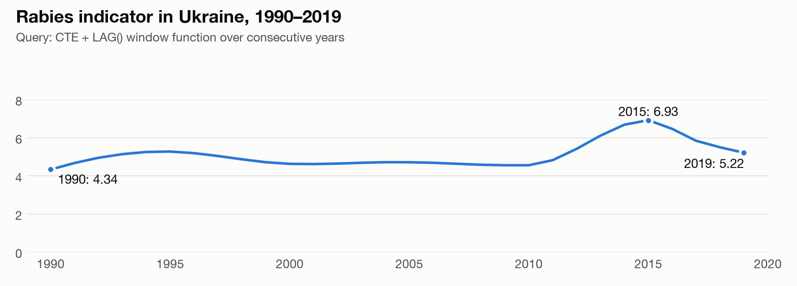
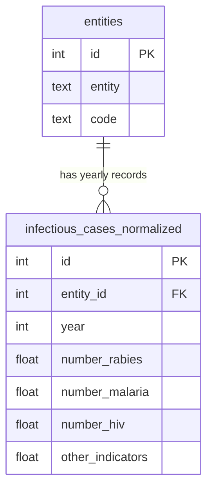

# Infectious Disease Analysis with PostgreSQL

**From a flat CSV to a normalized PostgreSQL database, analyzed with aggregates, window functions and custom SQL functions.**


[](https://colab.research.google.com/github/irenezvirkovska-hue/infectious-disease-sql-analysis/blob/main/infectious_disease_sql_analysis.ipynb)

Final project of the Relational Databases course (MSc Computer Science, Woolf / Neoversity).



## Dataset

[`infectious_cases.csv`](https://drive.google.com/file/d/1dQf-uVXzYPYYGgXsG1y4Q1qDdhP2miZl/view): **10,521 rows** of yearly indicators for nine diseases (rabies, malaria, HIV, tuberculosis, polio, cholera and others) across **245 entities**: countries plus regional and income groups such as "World" or "Low Income (WB)".

## What I did

### 1. Normalized the data

The flat table repeated each country's name and code in every row. I split it into a lookup table and a fact table:



Aggregate groups like "World" have no country code, and `NULL = NULL` is not true in SQL. A plain join would have silently dropped these rows, so the join uses `IS NOT DISTINCT FROM`:

```sql
JOIN pandemic.entities AS e
  ON ic."Entity" = e.entity
 AND ic."Code" IS NOT DISTINCT FROM e.code;
```

**Data integrity checks** (asserted in the notebook): 10,521 rows before and after normalization, 0 orphan records, 0 duplicate entities.

### 2. Analyzed with SQL

- **Aggregates:** average, min, max and total rabies indicator per entity, with first and last observation year; top 10 by average.
- **Date functions:** `MAKE_DATE`, `AGE`, `EXTRACT` and `CURRENT_DATE` to compute how many full years have passed since each observation.
- **Year-over-year change for Ukraine** with a CTE and the `LAG()` window function. The change is computed only for truly consecutive years (simplified from the notebook):

```sql
WITH yearly AS (
    SELECT n.year, n.number_rabies,
           LAG(n.year)          OVER (ORDER BY n.year) AS previous_year,
           LAG(n.number_rabies) OVER (ORDER BY n.year) AS previous_value
    FROM pandemic.infectious_cases_normalized n
    JOIN pandemic.entities e ON e.id = n.entity_id
    WHERE e.code = :country_code
)
SELECT year, number_rabies,
       CASE WHEN year = previous_year + 1
            THEN 100.0 * (number_rabies - previous_value) / NULLIF(previous_value, 0)
       END AS change_pct
FROM yearly;
```

### 3. Wrote custom SQL functions

- `year_difference(input_year)` returns the number of full years between January 1 of a given year and today.
- `average_cases(cases_value, divisor)` divides a yearly value into monthly, quarterly or half-year averages and returns `NULL` instead of failing on a zero divisor. It is covered by assertions in the notebook.

## Findings

- The top 10 by average rabies indicator is led by aggregate groups (World, income and regional groups). **India is the only single country in the top 10**.
- In Ukraine the indicator grew from **4.34 in 1990** to a peak of **6.93 in 2015**, then decreased to **5.22 in 2019**.
- Aggregate groups overlap with countries, so they should never be summed together. Missing values are left as `NULL` rather than replaced with zeros.

## Tech stack

PostgreSQL 16 (via `pgserver`, no separate installation) · SQLAlchemy · psycopg2 · pandas · Google Colab

## How to run

1. Click **Open in Colab** above.
2. Download [`infectious_cases.csv`](https://drive.google.com/file/d/1dQf-uVXzYPYYGgXsG1y4Q1qDdhP2miZl/view).
3. Run all cells and upload the CSV when prompted. PostgreSQL starts inside the Colab runtime, and all tables and functions are created automatically.

The notebook keeps its saved outputs, so the results can be read without running it.

---

Built by **Iryna Zvirkovska** · [GitHub](https://github.com/irenezvirkovska-hue) · [LinkedIn](https://www.linkedin.com/in/iryna-zvirkovska/)
